# Robot-Lipsync

**2D/3D Audio-Driven Facial Motion Modeling for a Humanoid Robot**

From audio-driven blendshapes to a physical robot: measuring audiovisual timing,
learning a differentiable facial-motion surrogate, and testing constrained 2D visual priors.

[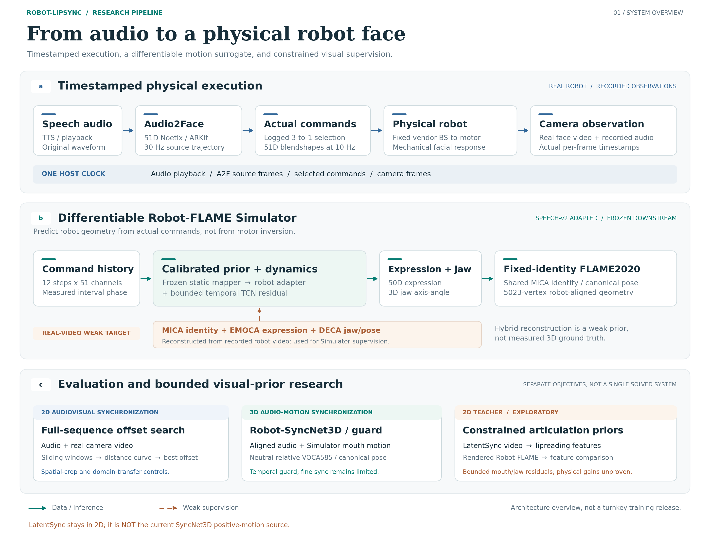](assets/figures/robot_lipsync_pipeline.svg)

**Research pipeline.** Blue: physical acquisition and 2D sync. Teal: differentiable geometry and
3D sync. Ochre: weak reconstruction supervision and exploratory 2D-teacher objectives.
[Editable SVG](assets/figures/robot_lipsync_pipeline.svg) / [Vector PDF](assets/figures/robot_lipsync_pipeline.pdf)
/ [Figure source and reading guide](docs/pipeline_figures.md).

This is a **curated research showcase**, not a complete training release or a turnkey robot controller.
It includes original temporal-model code, selected evaluation tools, reproducible metric tables,
small visual examples, and explicit negative results. No robot SDK, private implementation,
model weights, or full dataset is distributed.

## What This Project Investigates

A robot face is not a digital human. Low-rate commands, actuator coupling, mechanical delay,
restricted articulation, and non-human appearance all affect synchronization.
The research separates three questions:

- **Is the video synchronized?** Sequence-level audiovisual offset search, with spatial-input and domain-transfer controls.
- **What motion will the robot produce?** A differentiable 51D command-history-to-FLAME surrogate, supervised by weak reconstructions of real robot video.
- **Can a 2D teacher improve articulation?** Bounded mouth/jaw residuals, tested against amplitude, dynamics, and synchronization shortcuts.

The vendor blendshape-to-motor mapping is unchanged. There is no motor-to-blendshape inversion.
LatentSync remains a **2D teacher**, not the current SyncNet3D positive-motion source.

## Audio-Visual Synchronization

Original SyncNet weights are evaluated through complete sequences of sliding windows,
not isolated 200 ms decisions. A distance curve over temporal shifts produces a best offset
and a within-sequence relative score. Spatial preprocessing matters substantially.

| Protocol / model | Real clips | AUC | Balanced accuracy | 0 ms Top-1 | Offset MAE |
|---|---:|---:|---:|---:|---:|
| Original weights, project full-frame input | 8 | **0.9505** | 0.8958 | 0.750 | 25.0 ms |
| Original weights, manual face crop | 8 | 0.6563 | 0.6354 | 0.000 | 275.0 ms |
| Original weights, mouth ROI | 8 | 0.6784 | 0.6250 | 0.125 | 225.0 ms |
| Original weights, upstream tracked face crop* | 8 | 0.4115 | 0.5208 | 0.000 | 262.5 ms |
| Robot-SyncNet v2, project full-frame input | 8 | 0.9427 | **0.9271** | **0.875** | **12.5 ms** |

These tests use the same eight real test utterances; thresholds are selected on eight separate
validation utterances. *The upstream-crop row survives as a rounded experiment-report table;
its raw metric file is not available in the current archive. It is not independently recomputed here.*

**Interpretation:** temporal localization improved in v2, but AUC did not exceed the original-weight
full-frame baseline. This does not establish that adaptation eliminated the domain gap.
Full-frame input is a **project protocol**, not the upstream SyncNet face-crop protocol.

An earlier 54-clip camera-audio experiment recorded AUC **0.9788409**. It used different preprocessing,
offsets and confidence scoring, and selected the binary threshold on the evaluation set itself.
Its archived offset error is **530.98 ms**, under a different estimator; it must not be paired with
the 25 ms result above. Both records are retained in [the evidence tables](results/README.md).

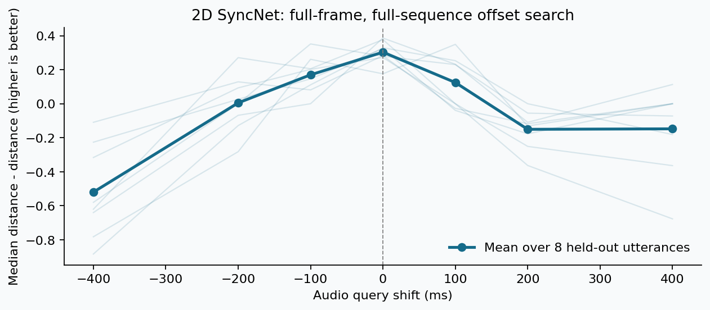
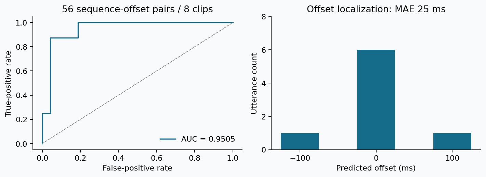

## Differentiable Robot-FLAME

[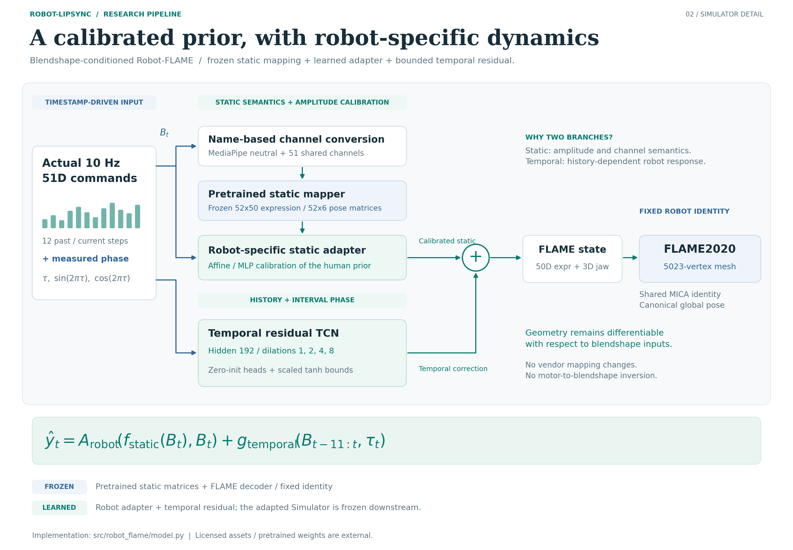](assets/figures/robot_flame_simulator.svg)

[Editable SVG](assets/figures/robot_flame_simulator.svg) / [Vector PDF](assets/figures/robot_flame_simulator.pdf).
The two branches separate static amplitude/semantic calibration from history-dependent dynamics.

The original project TCN uses dilations **1, 2, 4, 8**, explicit phase features, and bounded
expression/jaw residual heads. Name-based channel conversion is included: Noetix has ARKit's
51 non-tongue channels; the selected mapper actually expects **MediaPipe neutral + 51 shared
channels**, not an arbitrary 52D concatenation. Its matrices and FLAME decoder are external assets.

Hybrid targets use **fixed MICA identity + EMOCA v2 expression + DECA jaw/pose** with canonical
global pose for geometry comparisons. They are weak reconstructions, **not measured 3D ground truth**.

| Test domain / model | Mouth coordinate MAE | Jaw corr. | Inner corr. | Outer corr. | Width corr. | Asym. corr. |
|---|---:|---:|---:|---:|---:|---:|
| Controlled / static prior | 0.002646 | 0.277 | 0.138 | 0.398 | 0.378 | 0.051 |
| Controlled / static + temporal residual | **0.000298** | 0.947 | 0.867 | 0.953 | 0.925 | 0.805 |
| Speech v2 / frozen V1 | 0.002498 | 0.145 | -0.095 | 0.103 | 0.334 | 0.159 |
| Speech v2 / speech-adapted | **0.000531** | **0.830** | **0.649** | **0.841** | **0.769** | **0.543** |

Controlled results use 3,374 held-out trajectory frames. Speech v2 uses 31 held-out utterances /
3,709 frames, with **154/34/31 utterance-level train/val/test splits**. These are different domains
and model versions, not a single combined leaderboard. MAE is mean absolute coordinate error in
FLAME units, not Euclidean vertex distance or independently calibrated physical millimeters.

Speech adaptation improves outer-opening amplitude ratio to **0.966**, but inner opening (**0.764**)
and width (**0.806**) remain attenuated. Good correlation alone does not establish faithful articulation.
All amplitude ratios here use the **98th-minus-2nd percentile span**, prediction divided by target.

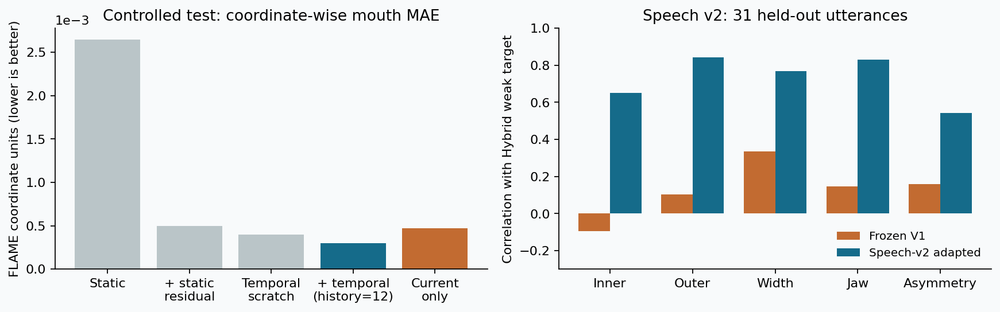
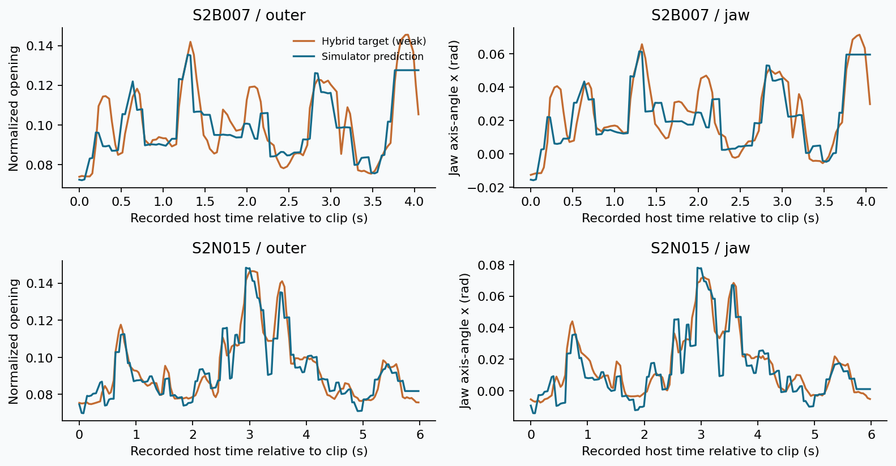

### More Motion Examples

[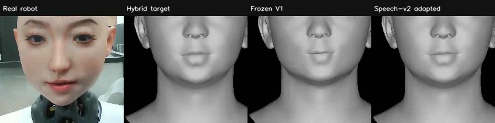](assets/videos/speech_natural.mp4)

Natural speech, left to right: real Noetix robot | Hybrid weak target | frozen V1 |
Speech-v2 adapted Simulator. [Watch the motion comparison](assets/videos/speech_natural.mp4).
Public clips are muted research illustrations, not listening tests.

[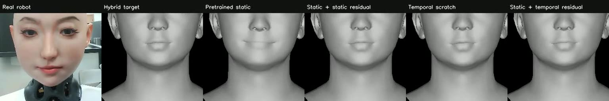](assets/videos/controlled.mp4)

Controlled test: real robot | Hybrid target | static prior | static residual | temporal scratch |
static + temporal residual. [Watch 24-second excerpt](assets/videos/controlled.mp4).

[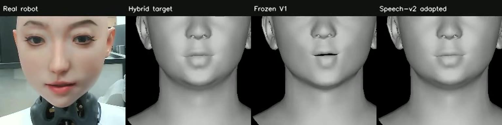](assets/videos/speech_bilabial.mp4)

Held-out bilabial speech: real robot | Hybrid target | frozen V1 | Speech-v2 adapted.
[Watch the full review clip](assets/videos/speech_bilabial.mp4).
See [media provenance and column order](assets/media_manifest.json).

## 3D Synchronization and 2D Teachers: What Is Not Solved

Speech v2 contains **219 utterances / 18.53 minutes** across natural, bilabial-dense,
vowel-contrast and articulation-transition speech. Actual commands and camera observations
share a traceable host-monotonic timeline. Current positives pair audio with Simulator outputs
on that timeline; the camera's measured rate is about 24.93 fps, not assumed to be 30 fps.

| Speech-v2 Simulator-positive model | Test AUC | Balanced accuracy | 0 ms Top-1 | Offset MAE |
|---|---:|---:|---:|---:|
| Scratch Eval, MFCC/L2, 200 ms | 0.6257 | 0.5891 | 0.1290 | 72.3 ms |
| Scratch Loss, Mel/cosine+ranking, 200 ms | 0.5784 | 0.5602 | 0.5484 | 87.7 ms |
| Ordered-ranking guard, 600 ms context | 0.6598 | 0.6230 | 0.1935 | 69.7 ms |

The 3D tests are harder and use different input and temporal protocols from the 2D experiments.
A mean curve peaking near zero **does not imply reliable per-utterance fine synchronization**.
The ordered-ranking model's +/-40 ms AUC is only **0.5095**. It is a candidate temporal guard,
not an unconstrained optimization oracle.

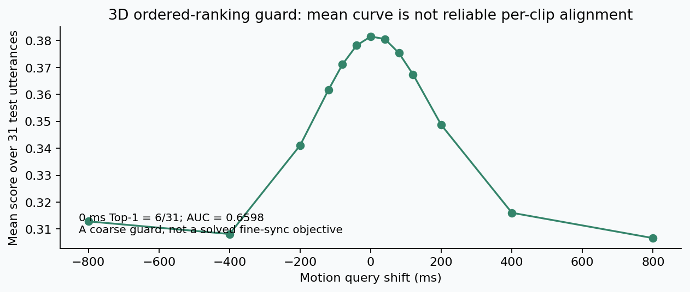

LatentSync / lipreading-space supervision is temporally sensitive and differentiable, but a
feature loss can be reduced by exaggerating motion rather than improving it. Direct optimization
produced **5.16x inner-opening amplitude** with weak constraints. Geometry, dynamics and a sync
guard reduced this to **1.21x** on eight short clips, without proving physical robot improvement.

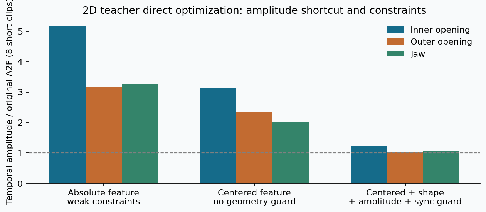

A separate shared-Refiner experiment used **40 train / 8 val / 8 test** utterances. With-teacher
features improved in 7/8 test clips, but FAN shape improved in only 3/8 and bilabial closure did
not improve consistently. The no-teacher objective admits identity as a zero-loss solution.
Renderer mouth-interior artifacts remain a limitation. **Full-scale Refiner training is not
justified by these results alone.** Teacher-derived textured videos are not bundled because
their asset provenance needs further rights review.

## Run What Is Released

Python 3.10+; CPU is sufficient for the bundled metric reproduction. In a checkout of this repository:

```bash
git clone https://github.com/Fanrito/Robot-Lipsync.git
cd Robot-Lipsync
python -m venv .venv
source .venv/bin/activate
python -m pip install -r requirements.txt
python scripts/evaluate_sync.py \
  --validation results/sync2d_val_curves.csv \
  --test results/sync2d_test_curves.csv \
  --output outputs/recomputed_sync.json
python scripts/plot_results.py
python scripts/draw_pipeline.py
```

Expected metric reproduction: **AUC 0.9505208333; balanced accuracy 0.8958333333; MAE 25 ms**.
This recomputes archived scores, not neural inference from withheld recordings.

For the original model structure, gradient smoke test, scalar geometry evaluation and tests:

```bash
python -m pip install -r requirements-models.txt
python scripts/smoke_model.py
python scripts/evaluate_flame.py \
  --curves results/speech_v2_descriptor_excerpt.csv \
  --output outputs/geometry_excerpt.json
python -m unittest discover -s tests -v
```

The smoke test uses **artificial matrices**, not a pretrained model or a scientific result.
Optional [SyncNet inference](docs/methodology.md#optional-2d-inference) requires independently
obtained upstream code, weights and prepared input. FFmpeg/ffprobe must be on `PATH` for video tools.
The [validation record](docs/validation.md) lists exact checks and the tested environment.
Full training, licensed FLAME reconstruction, pretrained Simulator inference and robot control
are **not** reproduced by this release. See [examples](examples/README.md).

## Repository Guide

```text
src/robot_flame/     Original predictor, channel schema, static adapters and TCN
src/syncnet/         Model-injected full-sequence inference wrapper
src/evaluation/      Geometry and validation-calibrated sync metrics
src/visualization/   File-only side-by-side utility
scripts/            Evaluation, plots, editable diagrams, inference and smoke-test CLIs
results/            Small tables, evidence JSONs, curves and provenance hashes
assets/             Muted MP4s, previews, metric plots and SVG/PNG/PDF pipeline figures
docs/               Protocol definitions, experiment boundaries and release scope
tests/              CPU regression tests, including split-leakage rejection
```

## Status and Next Steps

- [x] Real robot collection with traceable command/audio/camera timestamps.
- [x] 2D audiovisual synchronization and offset/crop ablations.
- [x] Blendshape-conditioned Robot-FLAME and speech-domain adaptation.
- [x] Robot-SyncNet3D experiments, domain diagnostics and gradient checks.
- [x] Bounded visual-teacher / Refiner feasibility and execution audits.
- [ ] Reliable held-out fine synchronization and confirmed physical articulation improvement.
- [ ] Multi-view geometry validation and stronger independent mouth observations.
- [ ] Rights-cleared reproducible data/weights and expanded training release.

## Attribution and Release Scope

Built on research from [SyncNet](https://github.com/joonson/syncnet_python),
[Wav2Lip](https://github.com/Rudrabha/Wav2Lip), [LatentSync](https://github.com/bytedance/LatentSync),
[FLAME](https://flame.is.tue.mpg.de/), [DECA](https://github.com/yfeng95/DECA),
[MICA](https://github.com/Zielon/MICA), [EMOCA](https://github.com/radekd91/emoca),
[MediaPipe-to-FLAME](https://github.com/PeizhiYan/mediapipe-blendshapes-to-flame),
and [Learn2Talk](https://arxiv.org/abs/2404.12888).

Original released code is [MIT licensed](LICENSE). Research media, model outputs and third-party
assets are **not relicensed under MIT**. No third-party implementation or weight is included.
See [THIRD_PARTY.md](THIRD_PARTY.md) and [release scope](docs/release_scope.md).
This repository does not claim a published paper, commercial readiness, or endorsement by the
robot manufacturer or upstream research groups.
